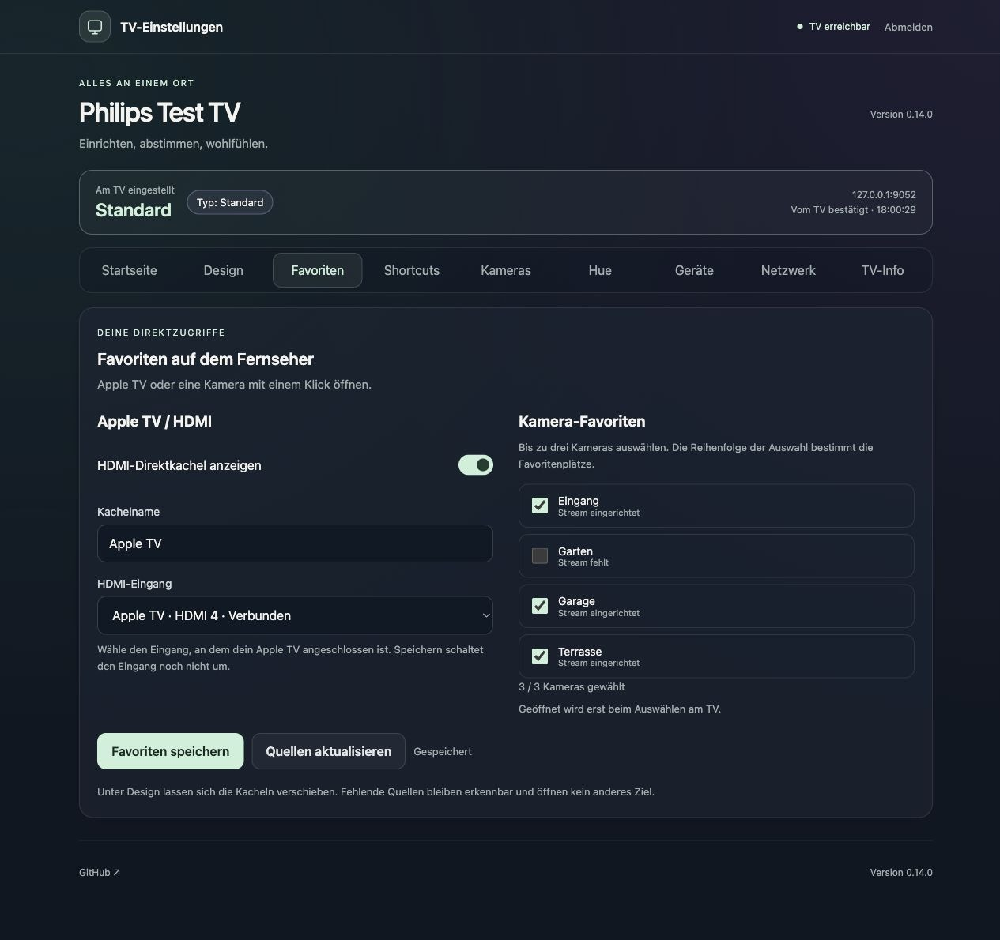

# Direct Home favorites

[Documentation](README.md) · [Profiles](PROFILES.md) · [Installation](INSTALLATION.md)

Version **0.14.0** adds a dedicated **Favoriten** section in the local IP dashboard: one HDMI shortcut with an editable name, and up to three camera favorites. All are opt-in. Saving discovers/configures local references; sources open only after selecting their TV tile.

[Phone view](images/web-favorites-mobile.jpg). The screenshot uses example sources, not a real home network.

## Configure Apple TV / HDMI

1. Open **Favoriten** in the IP dashboard.
2. Enable **HDMI-Direktkachel anzeigen** and keep **Apple TV** or enter your own **Kachelname** (1–40 characters).
3. Explicitly choose the HDMI input connected to the device. Names/ports/state come from Android's existing input catalog; no port number is built into the project.
4. Choose **Favoriten speichern**. On the TV, select the new tile and press OK to hand that exact input to the native TV application.

This is an HDMI-input favorite, not a network remote or app installed on Apple TV. Standby sources may be selected; a missing/disconnected source reports unavailable and never switches to another input. **Quellen aktualisieren** re-reads local metadata without discarding your open choices. Empty catalogs keep a clear selection prompt. Removing a source does not erase its saved reference automatically; disable it or choose another input.

## Configure camera favorites

Select up to **three** existing camera records, then save. Selection order assigns `camera1`–`camera3`; the slots can then move independently under **Design → Design & Anordnung**. Existing camera names remain the labels. The interface identifies missing streams and retains a named missing entry for a camera removed later, so it can be deselected.

A tile opens only the explicitly selected camera. Missing/unconfigured cameras show an unavailable message; an explicit deleted ID cannot fall back to another feed, including if removal races with playback startup. Normal default-camera fallback remains available when no explicit ID was requested. Existing Back and deliberate left/right camera switching remain unchanged.

The **Startseite → Kameras** visibility setting also hides camera-favorite tiles and suppresses their launch path. Favorites do not bypass that setting. No camera stream, thumbnail polling, pairing or provider request begins merely by opening settings, saving favorites or showing Home.

## Arrangement and profiles

There are fourteen reserved Home IDs: the previous ten plus `apple-tv`, `camera1`, `camera2`, `camera3`. Complete six/eight/ten-item orders upgrade by appending missing IDs, preserving every original relative position. Existing installations keep their presentation because new direct favorites default disabled/empty.

Up to ten visible tiles retain the existing two-row geometry. Eleven to fourteen use three compact rows, with at most five tiles per row; fourteen splits 5/5/4. Native and web previews agree. Vertical navigation goes to the adjacent row and the bottom row links to the network badge. Long labels/details are fitted to their cards.

New custom profiles capture the favorite configuration alongside presentation. Built-in Standard/Mediathek retain the current direct-favorite targets; Mediathek's camera visibility hides camera favorites. Older saved profiles without this field retain the current direct-favorite choice when applied. Unused reserved favorite slots are ignored only when comparing profile correspondence; saved full order remains restorable.

## Storage and authenticated API

`home_favorites` stores validated local references; `favorite_camera_labels` retains display labels for unavailable selected cameras. Provider URLs/certificates/keys stay in their existing protected stores and are not copied into these preferences or the favorite API.

| Route | Contract |
| --- | --- |
| GET `/api/favorites` | `{config,inputs,cameras,cameraLimit:3}`; local HDMI metadata and safe camera labels/availability |
| POST `/api/favorites` | Complete `{input:{enabled:boolean,id:string,name:string},cameras:[id...]}` |

All fields/types/counts are allowlisted. New input IDs must be exposed by the current local HDMI catalog; new camera IDs must exist in the library. Previously retained missing IDs can remain saved or be removed. All validation precedes one preference commit and revision advance. Existing session/origin/host guards apply; clients cannot provide launch intents, stream URLs or arbitrary actions.

Native clicks freshly revalidate their exact target. A successful HDMI handoff updates the existing last-input preference; it is not a continuous proof of physical routing. Settings and profile application never dispatch a source action.

## Validation and device boundary

The public and private installation builds pass signature checks. Production configuration/profile checks, web regression tests and exhaustive/seeded layout checks pass. The disposable-emulator probe exercises real storage/validation, intercepted exact camera dispatch, missing targets, profile migration, fourteen native tiles and actual D-pad movement across three rows/network. Browser save/reload and 320–1280 px widths are verified separately.

Physical HDMI handoff and real camera playback through these new tiles remain unverified. The home-TV network was unreachable during preparation, and the owner requested finishing/building/publishing only. **0.14.0 has not been installed on either physical TV.** Reconnect and inspect the selected TV before a later update; keep its existing sources, signing identity and preferences.
