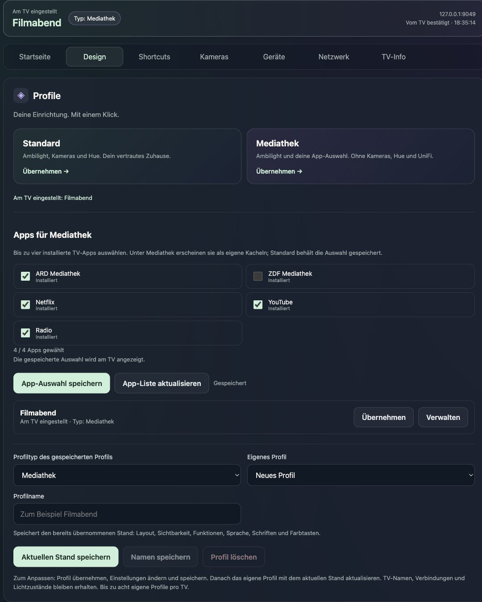

# Dashboard profiles

[Documentation](README.md) · [Installation](INSTALLATION.md) · [Current status](STATUS.md)

Open **Design → Profile** in the local IP dashboard. Choose **Standard**, **Mediathek** or up to eight custom profiles. The band above every section shows the last TV-confirmed **profile name**, **Typ: Standard/Mediathek**, TV address and check time. A later difference adds **Angepasst** while retaining the chosen name. Existing installations keep their setup on update; nothing is applied automatically.

Reviewed synthetic preview, including the custom name and app inventory. [Phone view](images/web-profiles-mobile.png).

## Built-in profiles

| Profile | Home and favorites | Integrations | Other defaults |
| --- | --- | --- | --- |
| Standard | Ambilight / Cameras / Hue above Television / Devices / System; favorite choices retained but hidden | Hue and UniFi enabled | Nordlicht, featured rows, clock/date on, German/default fonts and default color keys |
| Mediathek | Ambilight followed by your selected apps, then Television / Devices / System | Cameras hidden, Hue/UniFi disabled | Same neutral design, clock/date, language/fonts and key defaults |

Use **Übernehmen** on a preset card to apply it. These templates cannot be overwritten, renamed or deleted. They retain the current favorite IDs rather than forcing ARD/ZDF again. Personal TV names, provider configuration and light states stay separate. Turning an integration on does not configure or pair it.

## Choose apps for Mediathek

1. Directly below the preset cards, open **Apps für Mediathek**.
2. Select up to **four installed TV apps** and **App-Auswahl speichern**. ARD/ZDF remain the initial choices for retained older setups.
3. Apply **Mediathek** to show the choices. If already enabled, saving changes the TV tiles immediately. Standard keeps the same choices saved but hidden.
4. Move the favorite slots under **Design & Anordnung**, with drag or arrows. Their labels follow the chosen apps.

The list contains local Android TV launchers, excluding this dashboard. **App-Liste aktualisieren** re-reads installation state and preserves the open selection draft. A selected app removed later remains labelled **Nicht installiert** and can be deselected; it cannot be newly added while unavailable. Missing apps are never installed automatically. Selecting/saving does not sign in, start playback or open an app; TV OK launches it explicitly. The launcher inventory is bounded to 128 entries.

The four favorites use positional slots; changing the selection changes which app occupies those slots. There are ten reserved Home positions in total. Old six/eight-item orders gain missing slots while preserving every original relative position. Hidden slots keep their saved position. Nine/ten visible tiles use five per row.

## Create and adjust your own profile

1. Apply the desired template, then adjust and **save** Home visibility, integrations, app selection, design/order, language/fonts and color keys in their normal sections.
2. In **Design → Profile**, choose **Neues Profil**, set **Profiltyp des gespeicherten Profils**, enter a name and **Aktuellen Stand speichern**.
3. Use that saved profile's **Übernehmen** action to select it on the TV. **Verwalten** only opens its editor; it does not apply it.
4. To update it later, save the desired changes first, select the snapshot in the editor, then save the current state and confirm replacement.

The type categorizes the captured setup as Standard or Mediathek; changing the editor's type alone does not apply a template or reset its visibility/layout. To start from a template, apply its card first. The type, saved profile editor and actually selected TV profile are separate controls.

Names allow 1–40 characters; empty/control-character, duplicate and reserved preset names are rejected. **Namen speichern** changes only the name. **Profil löschen** removes only the snapshot, retaining current TV settings. Eight custom profiles can coexist. Deleting the selected snapshot leaves the presentation unchanged; the status then falls back to a matching/inferred identity.

A profile captures **persisted settings**, not unsaved form drafts. Applying a profile asks inline before discarding affected drafts; unrelated TV-name and camera-stream drafts remain. Conflicting covered saves/duplicate profile requests are blocked while pending. Errors retain acknowledged state and release controls.

## Selected, matching and modified

An explicitly applied custom profile keeps its selected name even if identical to a preset. Current settings are compared with that selected snapshot. Exact matches are marked confirmed; differences retain the selected name/type and add **Angepasst**. Updating that snapshot from the saved current setup clears the difference. Reading status never applies settings or rewrites a saved profile.

Older setups without a stored selected ID infer a matching profile, with built-ins first. If nothing matches, the type provides a fallback with the modified marker. Matching ignores only positions of unused reserved app slots, preventing newly appended hidden slots from making an old unchanged setup appear modified. Full stored orders remain retained and restorable.

## Profile scope

| Included | Retained separately |
| --- | --- |
| Explicit Standard/Mediathek type | Home heading, web name and sales model |
| Camera/clock/date visibility | Camera library, stream URLs, default camera and certificates |
| Theme, layout and ten-position order | Provider addresses, pairing, room/site and encrypted keys |
| Hue/UniFi feature switches | Actual light states and provider availability |
| Favorite app IDs and enabled state | App installation, sign-in and playback |
| Shared language and clock/text fonts | Android system language, Home assignment and packages |
| Four color-key assignments | Screensaver/activation and Hue standby automation |

Applying a profile sends no light, HDMI, pairing or provider command. A retained Hue standby option becomes eligible again when Hue is enabled and normal later standby conditions occur; profile application neither changes that option nor guarantees delivery. Already-dispatched operations elsewhere cannot be recalled.

## Confirmed, stale and local draft state

Visible authenticated pages recheck local profile metadata every **five seconds**, and on focus/return. Only one read is in flight, with an **eight-second** deadline; hidden/signed-out pages stop. Covered writes defer reads. Failure or a confirmation older than **fifteen seconds** removes positive status and marks the last known state unconfirmed. Recovery restores confirmation automatically. Late reads cannot supersede a newer profile application or logout.

Status updates preserve independent form values, focus and drafts. The address identifies this browser page's TV; check it when managing multiple televisions. Confirmation refers to saved settings, not proof that Home is foreground or that a provider is online. Reload an existing page after updating to receive the new controls.

## Storage and API

`dashboard_profiles_v1` holds at most eight private `{id,name,config}` snapshots, without provider credentials. The strict config contains `type`, `display`, `appearance`, `integrations`, `appShortcuts`, `interface` and `remote`. Older six-section configs and six/eight-slot orders normalize read-only. Apply persists `dashboard_profile_id` and `profile_type` alongside the allowlisted presentation in one commit. Built-ins are generated from fixed defaults and the current favorite selection.

| Authenticated route | Input / result |
| --- | --- |
| GET `/api/profiles` | Profiles, current config, exact-match `activeId`, chosen `selectedId`, `modified`, limit |
| POST `/api/profiles/save` | `{name,type?}` to create; `{id,name,type?}` to capture/replace current saved setup |
| POST `/api/profiles/rename` | `{id,name}`; configuration unchanged |
| POST `/api/profiles/delete` | `{id}`; custom snapshots only |
| POST `/api/profiles/apply` | `{id}`; validated configuration in one commit/revision advance |
| GET `/api/app-shortcuts` | `{enabled,apps,inventory,limit}` plus legacy availability fields |
| POST `/api/app-shortcuts` | Complete `{enabled:boolean,apps:[id...]}`, up to four unique entries |

Favorite IDs are aliases `ard`/`zdf` or `pkg:<dotted Android package>`. New IDs must resolve to installed TV apps; retained missing IDs remain saveable. Legacy `{ard,zdf}` inputs are accepted without silently dropping generic favorites. Inputs cannot provide launch URLs/intents, arbitrary configuration or provider secrets. Existing session/origin/host protections apply.

Profiles remain local to one installation. Export/import, cross-TV sync and GitHub-based app updates are separate work. A same-signature update keeps the store; uninstalling or clearing app data does not.

## Validation

`python3 tests/check_profiles.py`: 51 production validation/persistence checks with in-memory Android/snapshot adapters. `node tests/check_web.cjs`: 156 state/payload checks. `python3 tests/check_home_layout.py`: exhaustive retained eight-slot geometry plus 163,840 seeded ten-slot cases. Browser, installed-app discovery and actual TV launch/restoration evidence are listed separately in [Current status](STATUS.md).
